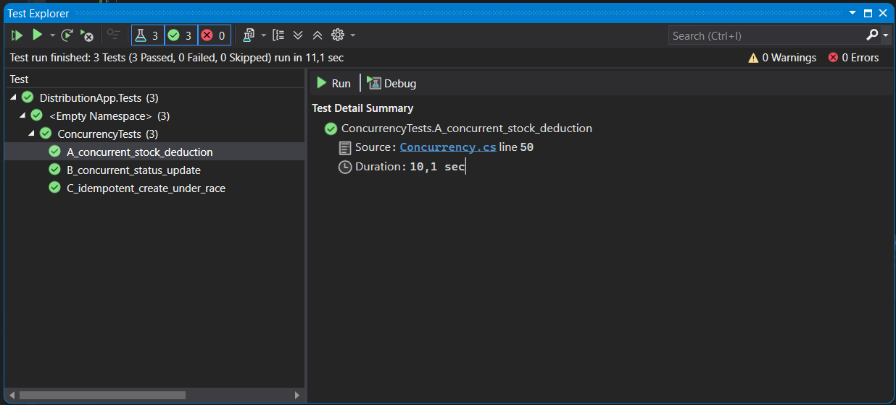
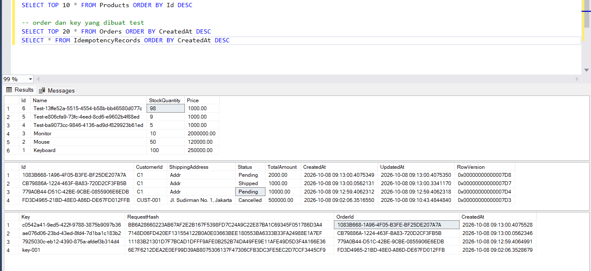

# DistributionApp - Order Management API

Prototype REST API untuk Order Management, dibangun dengan tujuan : **idempotency, concurrency-safe stock management, dan traceability**.

## Tech Stack

- ASP.NET Core Web API (.NET 8, controllers)
- Entity Framework Core 8 (code-first, migrations)
- SQL Server
- Swagger untuk dokumentasi dan uji manual
- xUnit + `WebApplicationFactory` untuk integration test concurrency (Unit Test)
 
## Cara Menjalankan

### 1. Prasyarat
- .NET 8 SDK
- Database SQL Server
- Visual Studio 2022

### 2. Konfigurasi database
Edit pada `appsettings.json`:
ex :
```json
"ConnectionStrings": {
  "Default": "Server=LAPTOP_KANTOR;Database=OrderDb;User Id=testing;Password=test1;TrustServerCertificate=True"
}
```

### 3. Buat database
ada 2 opsi

**A. Lewat migration (Package Manager Console, Default project: `DistributionApp`)**
```
Update-Database
```

**B. Lewat script SQL**
Run/execute code yang ada di `schema.sql` di SSMS pada database kosong.

Data Dummy awal (seed): Keyboard (stok 100), Mouse (50), Monitor (10).

### 4. Jalankan aplikasi
Untuk Run tekan F5 di Visual Studio, atau di menu atas pilih Debug lalu Start Without Debugging dan project akan berjalan di browser

Buka `https://localhost:<port>/swagger/index.html`.

### 5. Jalankan test
Stop aplikasi (Shift+F5) atau close browser tadi yang terbuka saat menjalankan aplikasi, lalu **Test > Test Explorer > Run All Tests**

Test memakai database yang sama dengan aplikasi, jadi SQL Server harus aktif.

## Endpoint

| Method | Path | Fungsi |
|---|---|---|
| POST | `/api/orders` | Buat order (wajib header `Idempotency-Key`) |
| GET | `/api/orders/{id}` | Detail order |
| GET | `/api/orders?status=&customerId=&from=&to=&page=&pageSize=` | List order dengan filter dan pagination |
| PATCH | `/api/orders/{id}/status` | Ubah status, body: `{ "status": "Confirmed" }` |
| POST | `/api/orders/{id}/cancel` | Batalkan order dan kembalikan stok |

Nilai status yang valid: `Pending`, `Confirmed`, `Shipped`, `Delivered`, `Cancelled`.

Contoh create:
**Idempotency-Key adalah UUID random bisa generate di website 

```
POST /api/orders
Idempotency-Key: 7f9c2f0e-0d5a-4b1f-9a33-1f2d3c4b5a6e

{
  "customerId": "CUST-001",
  "shippingAddress": "Jl. Sudirman No. 1, Jakarta",
  "items": [ { "productId": 1, "quantity": 2 } ]
}
```

- `201 Created`: order baru dibuat.
- `200 OK` dengan header `Idempotent-Replayed: true`: request ulang dengan key dan isi yang sama, mengembalikan order yang sama.

### Aturan status

```
Pending   -> Confirmed | Cancelled
Confirmed -> Shipped   | Cancelled
Shipped   -> Delivered
Delivered / Cancelled -> terminal (tidak bisa diubah)
```

Aturan ini ada di class `OrderStatusRules` di hardcode bukan ambil dari table. Cancel hanya bisa dari `Pending` atau `Confirmed`, dan stok otomatis dikembalikan. Permintaan `PATCH status = Cancelled` dialihkan ke logika cancel yang sama sehingga stok tetap kembali.

## Pilihan Database: SQL Server

- Transaksi ACID penuh, jadi kurangin stok dan simpan order bisa jadi satu paket: berhasil semuanya atau batal semuanya.
- Ada rowversion bawaan, saya pakai buat ngecek kalau status order diubah dua orang bersamaan.
- UPDATE di SQL Server ngunci per baris, jadi pengurangan stok bisa dibuat atomik tanpa bikin semua request lain ikut ketahan.
- Primary key dan unique index-nya tegas, jadi bisa jadi pegangan buat idempotency waktu ada request yang masuk barengan.
- Sudah terpasang di laptop saya, jadi tinggal pakai.

Skema tersedia sebagai migration (folder `Migrations`) dan script `schema.sql`.

## Idempotency

**Strategi:** header `Idempotency-Key` + hash payload + primary key unik di tabel `IdempotencyRecords`.

Alur:
1. Client mengirim `Idempotency-Key` (misalnya GUID yang dibuat saat form dibuka). Double-click atau retry memakai key yang sama.
2. Server mengecek key. Jika sudah ada dan hash payload sama, order yang sudah dibuat dikembalikan (200, tanpa membuat order baru).
3. Jika key sama tetapi isi request berbeda, server menjawab **422** (kesalahan client).
4. Jika key belum ada, server mengklaim key di dalam transaksi yang sama dengan pembuatan order.

**Alasan pemilihan:**
- Header `Idempotency-Key` adalah pola standar industri (dipakai API pembayaran) sehingga mudah diadopsi client.
- Hash payload mendeteksi penyalahgunaan key (key yang sama untuk order berbeda).
- **Unique constraint di database adalah satu-satunya mekanisme yang benar saat dua request tiba persis bersamaan.** Pengecekan "jika belum ada, baru buat" di kode saja bisa lolos di kedua request (check-then-act). Dengan primary key, request kedua pasti menunggu atau gagal dengan duplicate key (error 2627/2601), lalu mengembalikan order milik request yang menang.
- Key diklaim **sebelum** stok disentuh dan dalam transaksi yang sama dengan order. Jika order gagal (misalnya stok kurang), klaim key ikut rollback, sehingga client boleh mencoba lagi.

Hash payload tidak peka terhadap urutan item.

## Concurrency Handling

### Skenario A: Concurrent Stock Deduction
Dua order masing-masing butuh 10 unit, stok 15.

**Solusi: atomic SQL operation.**

```sql
UPDATE Products SET StockQuantity = StockQuantity - @qty
WHERE Id = @id AND StockQuantity >= @qty
```

(ditulis dengan LINQ `ExecuteUpdateAsync`.) Pengecekan dan pengurangan terjadi dalam satu statement. Jika 0 baris terpengaruh, stok tidak cukup dan order ditolak dengan **409**. Dua request tidak mungkin sama-sama membaca stok 15 karena tidak ada langkah "baca lalu tulis" di aplikasi. Lapisan tambahan: `CHECK (StockQuantity >= 0)` di database sebagai jaring pengaman terakhir.

**Mengapa bukan pessimistic lock:** `UPDLOCK` memperpanjang waktu kunci dan menurunkan throughput. Atomic update menahan kunci hanya sesingkat satu statement.

### Skenario B: Concurrent Status Update
Dua admin mengubah order yang sama (Shipped vs Cancelled).

**Solusi: optimistic locking dengan `RowVersion`.** Kolom `rowversion` pada `Orders` dicek saat `SaveChanges`. Jika sudah diubah request lain, EF melempar `DbUpdateConcurrencyException` dan API membalas **409 Concurrency Conflict**. Hanya satu yang menang, yang lain mendapat error jelas.

**Mengapa optimistic:** konflik pada order yang sama jarang terjadi, sehingga tidak perlu mengunci baris dan menahan request lain. Kasus langka itu cukup ditangani dengan menolak yang kalah.

### Skenario C: Idempotent Create Under Race
Dua request POST dengan key sama tiba bersamaan.

**Solusi: primary key unik pada `IdempotencyRecords`** yang diklaim di dalam transaksi pembuatan order. Request kedua menunggu hasil request pertama, lalu mengembalikan order yang sama. Hasil akhir: satu order, satu pengurangan stok.

## Race Condition Lain yang Dicegah

1. **Cancel ganda mengembalikan stok dua kali.**
   Dua cancel bersamaan pada order yang sama bisa sama-sama menambah stok. Dicegah dengan menyimpan perubahan status lebih dulu menggunakan `RowVersion` sebelum stok disentuh. Cancel kedua gagal di tahap itu (409) dan stok hanya dikembalikan sekali. Penambahan stok dilakukan di database (`StockQuantity = StockQuantity + qty`), bukan dengan cara baca-ubah-simpan.

2. **Deadlock antar order dengan item berlawanan urutan.**
   Order 1 butuh produk A lalu B, order 2 butuh B lalu A, dan saling menunggu. Dicegah dengan mengurutkan item per `ProductId` sebelum update stok (baik saat create maupun cancel). Jika deadlock SQL (error 1205) tetap terjadi, API menjawab **409 "please retry"**, bukan 500.

3. **Produk yang sama muncul dua kali dalam satu order.**
   Dua baris dengan produk sama bisa menghasilkan dua update yang saling berinteraksi dan total yang salah. Dicegah dengan menggabungkan item memakai `GroupBy(ProductId)` sebelum diproses.

4. **Harga produk berubah setelah order dibuat.**
   Harga disalin ke `OrderItem.UnitPrice` saat order dibuat sehingga riwayat tidak berubah.

5. **Jalur pembatalan yang melewati pengembalian stok.**
   `PATCH status = Cancelled` dialihkan ke logika cancel yang sama, sehingga tidak ada jalur yang membatalkan order tanpa mengembalikan stok.

6. **Pengurangan stok parsial.**
   Pengurangan stok semua item dan penyimpanan order berada dalam satu transaksi. Jika satu item gagal, seluruh perubahan di-rollback.

## Validasi dan Error Handling

Semua error memakai format `ProblemDetails` (RFC 7807) yang sama, berisi `traceId` dan `correlationId`.

| Status | Kondisi |
|---|---|
| 400 | Header `Idempotency-Key` hilang, body tidak valid, nilai enum tidak dikenal |
| 404 | Order atau produk tidak ditemukan |
| 409 | Stok tidak cukup, transisi status tidak valid, konflik concurrency, deadlock (silakan retry) |
| 422 | `Idempotency-Key` dipakai ulang dengan isi request berbeda |
| 500 | Error tak terduga (detail disembunyikan dari client, dicatat di log) |

Validasi input memakai DataAnnotations (`Required`, `Range`, `MaxLength`, `MinLength`), antara lain quantity 1 sampai 10.000 dan minimal satu item per order.

## Logging dan Traceability

- Logging terstruktur (JSON) lewat `ILogger` bawaan ASP.NET Core, tanpa `Console.WriteLine`.
- Middleware `CorrelationIdMiddleware`: membaca header `X-Correlation-Id` dari client atau membuat yang baru, lalu memasangnya sebagai *logging scope* sehingga **semua log dalam satu request otomatis memuat `CorrelationId`**.
- Correlation ID dikembalikan di header response dan di body error, sehingga tim ops dapat mencari seluruh log dari satu ID yang dilaporkan user.
- Setiap request dicatat (method, path, status code, durasi). Kejadian bisnis penting dicatat: order dibuat, replay idempotent, perubahan status, cancel dan pengembalian stok, serta konflik.

## Pengujian

Project `DistributionApp.Tests` berisi integration test terhadap SQL Server sungguhan (bukan InMemory, karena InMemory tidak mendukung transaksi dan concurrency yang sebenarnya). Request dikirim paralel dengan `Task.WhenAll`.

| Test | Skenario | Hasil yang diharapkan |
|---|---|---|
| `A_concurrent_stock_deduction` | Stok 15, dua order masing-masing 10 | 1 x 201, 1 x 409, stok akhir 5 |
| `B_concurrent_status_update` | Shipped vs Cancel bersamaan | 1 x 200, 1 x 409 |
| `C_idempotent_create_under_race` | 20 request, key sama | 1 x 201, sisanya 200, satu order id, stok berkurang sekali |

Bukti dari database setelah test: stok produk A = 5, produk C = 98 (100 - 2, hanya sekali), dan tabel `IdempotencyRecords` hanya memiliki satu baris per order.

Uji manual lewat Swagger yang telah dilakukan: create, replay idempotent, key dengan isi berbeda (422), tanpa header (400), stok tidak cukup (409), produk tidak ada (404), alur status, serta cancel dengan pengembalian stok.

### Hasil Test



### Bukti di Database



## Struktur Project

```
DistributionApp/
  Controllers/    OrdersController
  Data/           AppDbContext (konfigurasi, seed, constraint)
  Domain/         Entities (Product, Order, OrderItem, IdempotencyRecord, OrderStatusRules)
  Dtos/           Request/response model
  Exceptions/     Domain exceptions + GlobalExceptionHandler
  Middleware/     CorrelationIdMiddleware
  Services/       OrderManager (logika bisnis), IdempotencyHelper
  Migrations/     EF Core migrations
DistributionApp.Tests/   ConcurrencyTests
schema.sql
```


## Keterbatasan dan Next Step

- Record idempotency belum dibersihkan otomatis. Perlu hal seperti sql job clear data otomatis di waktu tertentu.
- Belum ada autentikasi dan otorisasi.
- Belum ada retry otomatis untuk deadlock transien. Saat ini deadlock dijawab 409 agar client dapat retry.
- Logging masih ke console.
- stok langsung berkurang begitu order dibuat, walaupun statusnya masih Pending